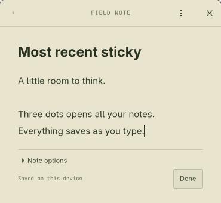

# NERV Fieldnotes

A native Rust sticky notes application for Arch Linux, using GTK4 and SQLite.
Launching it opens your most recently edited sticky note in a small desktop window.
The three dots in its top-right corner open the complete notes board.



## Use it

Launch **NERV Fieldnotes** from your application menu, or run `~/.local/bin/nerv-fieldnotes`.
Type directly into the sticky.
Changes save automatically after a short pause and when you close the window.
Use **+** for another sticky and the dots menu for all notes, forwarding, archive, and trash.
Expand **Note options** for tags, paper color, pinning, and checklist mode.

Each sticky is an independent, resizable native window.
Its size is remembered when you close it.
The note board provides search, pinned notes, archive, trash, restoration, duplication, and agent inbox access.
The board is built separately from the default sticky experience and stays hidden until requested.

| Shortcut | Action |
| --- | --- |
| Ctrl+N | New sticky |
| Ctrl+K or Ctrl+/ | Open board and search |
| Ctrl+S | Save current sticky |
| Ctrl+Enter | Save and close current sticky |
| Escape | Close sticky or hide board |
| Ctrl+Z | Undo the last move from the board, outside text fields |
| F1 | Keyboard reference |

## Install on Arch Linux

The runtime requires GTK4 and SQLite.
Building also requires Rust and pkgconf.

```sh
sudo pacman -S --needed rust pkgconf gtk4 sqlite
bash scripts/install-native.sh
```

The installer builds an optimized binary, installs it under `~/.local/bin`, registers the app in the desktop application list, and adds **New note** and **All notes** launcher actions.
The installed binary runs independently of the repository.
It replaces the earlier browser launcher and disables its old local service while preserving existing data.

```sh
nerv-fieldnotes             # most recent sticky
nerv-fieldnotes --new-note  # new sticky
nerv-fieldnotes --board     # full board
```

Use `~/.local/bin/nerv-fieldnotes` if `~/.local/bin` is not on your PATH.

## Forward to your agents

Open the dots menu and choose **Forward to agent**.
Review the handoff, add a destination and instructions, then copy it, save Markdown, or send it to the local inbox.
Agents can use the included native CLI directly, without a local web service.

```sh
~/.local/bin/fieldnotes-agent list --agent codex
~/.local/bin/fieldnotes-agent show HANDOFF_ID
~/.local/bin/fieldnotes-agent ack HANDOFF_ID
```

The CLI returns JSON.
An acknowledgement means received, not completed.
The app never executes note text or starts an agent automatically.

## Data and backups

Notes, drafts, settings, and the inbox live in `$XDG_DATA_HOME/nerv-fieldnotes/inbox.sqlite3`, normally `~/.local/share/nerv-fieldnotes/inbox.sqlite3`.
They are stored outside Git and survive uninstalling the application.
Handoff Markdown snapshots live in the neighboring `inbox/` directory.

Use the board's **Export backup** and **Import backup** controls, or the CLI:

```sh
nerv-fieldnotes export backup.json
nerv-fieldnotes import backup.json
```

JSON exports include saved notes in all states.
They do not include the agent inbox, so back up the entire data directory separately when needed.
Imports validate the complete file before merging and keep the newer version of a note with the same ID.
Version 1 backups from the original browser app can be imported directly.
The original source is preserved at the [`v1-web` tag](https://github.com/bananatruck/nerv-fieldnotes/tree/v1-web).
Browser-local notes must be exported from that version before import.

## Development

```sh
cargo test --manifest-path native/Cargo.toml --locked -j 1
cargo clippy --manifest-path native/Cargo.toml --all-targets --locked -j 1 -- -D warnings
cargo build --manifest-path native/Cargo.toml --release --locked -j 1
```

[Usage and CLI guide](native/README.md) · [Native design](native/DESIGN.md) · [Verification](native/VERIFICATION.md)

The desktop window manager controls window placement and any always-on-top setting.
Pinning a note marks it as a favorite in Fieldnotes.
The app does not synchronize devices.

```sh
bash scripts/uninstall-native.sh
```
